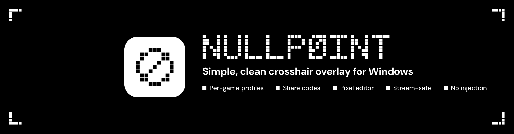

<p align="center"></p>

---

## Features

- **Crosshair builder**: color, outline, soft shadow, center dot, inner/outer lines (solid / dashed / dotted), ring,
  rotation, 11 shapes (incl. Hexagon, Triangle, Diamond, thick Plus), static / gradient / rainbow color, colorblind presets
- **Text crosshairs**: any 1-3 characters (+ • × ◆) in any font
- **Image crosshairs**: PNG, animated GIF and SVG, with scale/opacity/rotation
- **Pixel editor**: draw your own crosshair on a 16/32/64 grid and save it as PNG
- **Per-game profiles**: auto-switches when you focus Fortnite, VALORANT, CS2, Apex, Overwatch 2, Roblox, Minecraft, Warzone, or any game you add
- **True centering**: centers on the game window (windowed / borderless / stretched / multi-monitor) with X/Y fine-tune
- **Share codes**: copy/paste a short code, QR, share card PNG, `nullpoint://import/...` links, import from a QR screenshot
- **Import VALORANT and CS2 / CS:GO codes** (e.g. from [vcrdb.net](https://www.vcrdb.net/), or `CSGO-...` share codes):
  paste the code on the Share tab; it's converted locally (nothing is fetched) and sized to match in game
- **Community gallery**: browse and import crosshairs from [`gallery/`](gallery/) ([add yours](gallery/CONTRIBUTING.md))
- **Library & backup**: thumbnails, tags, search, favorites, compare mode; export/import everything as one file
- **Workflow**: hold-to-hide (e.g. Mouse2), quick switcher (Alt+X), hotkey cheat sheet (hold F1), settings search,
  copy a profile to other games
- **Stream-safe mode**: hide the crosshair from OBS / Streamlabs capture, or show it
- **Tools**: eDPI calculator, resource monitor, low-power mode on battery, portable mode (USB stick)
- **Extras**: OBS stream page, optional Discord Rich Presence, alignment test, black & white dark/light theme,
  first-run wizard, undo/redo, crash reports that stay on your PC
- **Languages**: English, العربية, Deutsch, Español, Français, Italiano, Polski, Português (Brasil), Русский, Türkçe, 日本語, 한국어, 简体中文

## Safety

Nullpoint is a **separate click-through window**. It does **not** inject into games, hook graphics, or read game memory or pixels.
Use any third-party overlay at your own discretion, especially in ranked modes.

> **Note:** Overlays can't draw over *exclusive* fullscreen. Set your game to **Windowed Fullscreen / Borderless**.

## Install

**Option 1 — installer (recommended):** download `Nullpoint-Setup-x.y.z.exe` from [Releases](../../releases).
Per-user install, no admin; Start menu shortcut, optional desktop shortcut and "Start with Windows".

**Option 2 — portable .exe:** download `Nullpoint.exe` from [Releases](../../releases). Put an empty
`portable.txt` next to it to keep all settings in a `data` folder beside the exe.

Windows may show **"Windows protected your PC"**: see [docs/SMARTSCREEN.md](docs/SMARTSCREEN.md) for how to verify
the download with its SHA-256 checksum and run it safely.

**Option 3 — from source (Windows 10/11, Python 3.11+):**

```bat
git clone https://github.com/yensobased1/nullpoint.git
cd nullpoint
setup.bat
run.bat
```

## Hotkeys

| Key | Action |
|---|---|
| `F8` | Show / hide overlay |
| `F9` | Open settings |
| `Ctrl+Z` / `Ctrl+Y` | Undo / redo in the settings window (paint strokes on the Editor tab) |
| `Esc` | Close the alignment test / quick switcher |
| `Alt+X` | Quick switcher (8 library favorites, keys 1-8) |
| hold `F1` | Hotkey cheat sheet |
| hold (off by default) | Hide the crosshair while held, e.g. `Mouse2` for ADS |

Hotkeys can be changed in **App Settings**.

## Settings location

`%APPDATA%\Nullpoint\config.json` (or `data\` next to `Nullpoint.exe` in portable mode).

## Translations

German, Spanish, French, Italian, Polish, Portuguese (BR), Russian, Turkish, Japanese, Korean and Simplified
Chinese are **machine-translated**. Fixes are very welcome: see [docs/TRANSLATING.md](docs/TRANSLATING.md)
(the keys in `crosshair/lang/<code>.json` are the English text, the values are your language).
`python crosshair/lang_report.py` lists missing keys; `test_lang.py` checks that every language has every key.

## Details

Tray menu: Show overlay, Open Settings, Add current game, Alignment test, Switch Profile, Exit.
Double-click the tray icon = settings. Closing the settings window keeps the app running.

Build the .exe yourself with `build.bat` (PyInstaller): it makes `dist\Nullpoint.exe`.
Tests: `cd crosshair` then `..\.venv\Scripts\python -m unittest test_share_code test_render test_lang`

### Settings window (tabs)
Left side (hidden on the Editor tab): profile, mode (Line crosshair / Image), live preview, Undo/Redo.
The preview uses the exact same draw call as the overlay. Background Checker / Dark / Grey / Light,
zoom 1x (true size) / 2x / 4x / 8x with sharp pixels, optional pixel grid.

#### Crosshair
- **Shape**: Cross, T-Shape (no top line), Dot only, Circle, Square (box), Chevron (^), X (45 degrees).
  Line rotation 0-90 degrees.
- **Color**: presets + hex. "Use same color for all" (on by default); off = separate Lines, Center dot,
  Ring and Outline colors. Color mode Static / Rainbow (speed, saturation; a ~15 fps timer runs only
  while rainbow is on and the overlay is visible).
- **Outline**: on/off, thickness, opacity. Grows every part evenly on every side, under the fill.
- **Center Dot**, **Inner Lines**, **Outer Lines**: length, thickness, gap, opacity, optional separate
  vertical length.
- **Ring**: show, radius, thickness, opacity, number of gaps (0-8), gap size, gap rotation. Works with lines
  and the dot.
- Every section has "Reset to default".

Geometry: gap = px from the center to the first pixel of a line, length = px of each line, thickness = line
width. The screen center is the edge between the two middle pixels; even sizes are centered on it exactly,
odd sizes sit on the pixel right/below it. Lines, dot and box draw without antialiasing (pixel exact);
ring, chevron and rotated lines are antialiased.

#### Image
PNG, GIF (animated, max ~15 fps, "Pause animation") or SVG (rendered crisp at the exact size).
Scale 10-400%, opacity, rotation 0/90/180/270, always centered on the center pixel. Path is per profile.

#### Editor
- Canvas 16x16 / 32x32 / 64x64 (changing size asks first). Red lines = the screen center.
- Left mouse paints, right mouse erases. Tools: Pencil, Eraser, Line, Rectangle, Fill, Eyedropper.
  Brush 1-3 px, color + opacity, last 8 colors, mirror Horizontal / Vertical / Both.
- Live 1x (real size) and 4x previews. Clear, Load PNG to edit (up to 64x64), Save as PNG,
  Save + Apply (Image mode, 100%, no rotation = exact pixels), Add to Library.
- Saved to `%APPDATA%\Nullpoint\custom\`: exact pixels, transparent background.

#### Library
Saved crosshairs with thumbnails (same renderer). Click = apply to the current profile.
Save current to library, Apply, Rename, Duplicate, Delete. Stored in `%APPDATA%\Nullpoint\library.json`.

#### Games & Display
Every 500 ms the app checks the focused window's process name:

| Process | Profile |
|---|---|
| `FortniteClient-Win64-Shipping.exe` | Fortnite |
| `VALORANT-Win64-Shipping.exe` | VALORANT |
| `cs2.exe` | Counter-Strike 2 |
| `r5apex.exe`, `r5apex_dx12.exe` | Apex Legends |
| `Overwatch.exe` | Overwatch 2 |
| `RobloxPlayerBeta.exe` | Roblox |
| `javaw.exe` (window title contains "Minecraft"), `Minecraft.Windows.exe` | Minecraft |
| `cod.exe` | Call of Duty |
| anything else | Default, or hidden with "Hide when game isn't focused" (on by default) |

- Add games: browse for an `.exe`, type a process name, or tray **Add current game** (uses the last focused
  program, makes a copy of Default named after the window title). Rename profile... renames the active one.
- Per profile: **Monitor** (Follow game window / Monitor 1, 2, ... with resolution), X/Y offset (-50..+50 px),
  **Stretched resolution** (in-game width/height, native width auto-detected or typed). When on, the
  crosshair is stretched horizontally by native width / in-game width, shown as "Horizontal scale".
  Note: if Windows itself runs at the stretched resolution, the monitor already stretches the overlay;
  leave this off in that case.
- In a game the crosshair centers on the game window's client area (windowed, borderless, multi-monitor).

#### Share
- Share code: Copy Code, Paste Code, **Show QR** (popup, Save QR as PNG).
- Backup: **Export all...** writes one `.json` with every profile, the library and all settings, custom
  images embedded (base64). **Import...** asks Merge or Replace. Bad files show an error; every imported
  value is type-checked and clamped.

#### App Settings
Hide when game isn't focused, Fullscreen mode, hotkeys, Start with Windows,
**Hide crosshair from recordings/streams** (SetWindowDisplayAffinity WDA_EXCLUDEFROMCAPTURE, Windows 10 2004+:
you see it, OBS / screenshots don't; a message appears if Windows doesn't support it),
**Theme** System / Dark / Light (System follows the Windows app theme), **Language** English / العربية
(right-to-left, applies without restart), **Update check** (GitHub `owner/repo`, empty = off; at most once a
day, notification only, click it to open the release page; never downloads anything), **Alignment test**
(full screen 1px grid + exact center lines + resolution on the selected monitor; the crosshair draws on top).

### Fullscreen
Normal windows cannot draw over **exclusive** fullscreen. Fullscreen mode:
- **Auto**: when Windows reports an exclusive-fullscreen game in front, a tray notice asks you
  to switch the game to Windowed Fullscreen / Borderless.
- **Borderless**: never warn. **Exclusive**: always warn when a mapped game is focused.

The overlay re-asserts "topmost" every time focus changes, so it survives Alt+Tab.

### Share codes (XH3, reads XH1 / XH2)

XH3 adds: `h` shadow (on, size 0-6, opacity), `y` gradient (on, tip color), `l` line style
(`s` solid / `d` dashed / `o` dotted, dash 1-10, gap 1-10), `x` text (%-encoded characters, size 8-96, bold,
opacity, %-encoded font), mode `t` = text, shapes `6` hexagon, `3` triangle, `4` diamond, `p` plus.
The table below lists the XH2 fields, which XH3 keeps unchanged.
Our own format. VALORANT codes can be imported (Share tab), but Nullpoint codes are not VALORANT codes. Example:

```
XH2;m:l;c:00FFFF;o:1,1,0.5;d:1,2,1;i:1,6,2,3,0.8,0,6;e:0,2,2,10,0.35,0,2;p:100,1,0;g:0,10,1,1,0,20,0;w:0,5,1;s:c;r:0;k:1,00FFFF,00FFFF,00FFFF,000000
```

| Key | Values (comma separated) | Ranges |
|---|---|---|
| `m` | mode: `l` = lines, `p` = image | |
| `c` | main color `RRGGBB` | hex |
| `o` | outline: on, thickness, opacity | 0/1, 1-6, 0-1 |
| `d` | center dot: on, size, opacity | 0/1, 1-10, 0-1 |
| `i` | inner lines: on, length, thickness, gap, opacity, separate-vertical, vertical length | 0/1, 0-30, 1-10, 0-40, 0-1, 0/1, 0-30 |
| `e` | outer lines: same as `i` | |
| `p` | image: scale %, opacity, rotation | 10-400, 0-1, 0/90/180/270 |
| `g` | ring: on, radius, thickness, opacity, gaps, gap size, gap rotation | 0/1, 1-50, 1-10, 0-1, 0-8, 0-90, 0-359 |
| `w` | rainbow: on, speed, saturation | 0/1, 1-10, 0-1 |
| `s` | shape: `c` cross, `t` T, `d` dot, `o` circle, `q` square, `v` chevron, `x` X | |
| `r` | line rotation | 0-90 |
| `k` | colors: same-for-all, lines, dot, ring, outline | 0/1, hex x4 |

Missing keys use defaults, unknown keys are ignored, out-of-range numbers are clamped, anything else
gives a clear error. XH1 codes (no `g w s r k`) still load. Image codes hold settings only, not the image.

### Files
- First start after the rename copies `%APPDATA%\CrosshairOverlay\` (config, library, custom images)
  to `%APPDATA%\Nullpoint\` and repoints image paths. The old folder is left as a backup.
- Config: `%APPDATA%\Nullpoint\config.json`, saved ~0.3 s after each change. Old configs load;
  new built-in games are added once. A corrupt file is renamed to `config.json.corrupt-<time>.bak`.
- Library `library.json`, editor/imported images `custom\`, crash log `error.log` (same folder).
- UI text: `crosshair/lang/en.json`, `crosshair/lang/ar.json`.

### Notes
- The app runs in physical pixels (Qt high-DPI scaling off, per-monitor DPI aware), so the crosshair is
  pixel exact at 125%/150%. The settings window may look small on high-DPI screens.
- No render loop: the overlay redraws only on change, except rainbow / GIF (~15 fps, only while on).

## License

[MIT](LICENSE)
